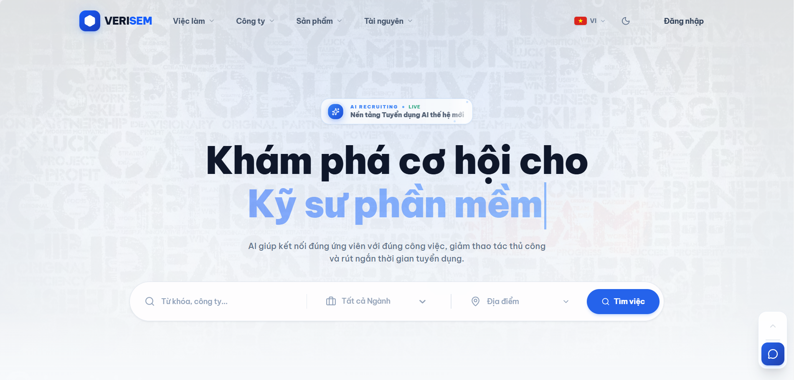
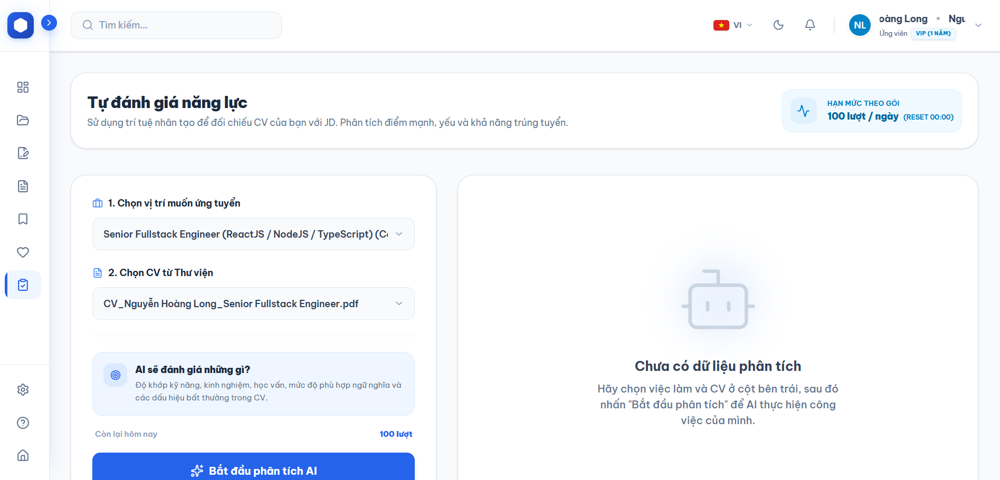
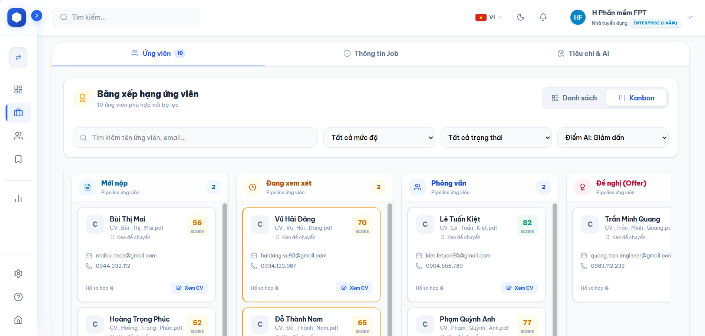
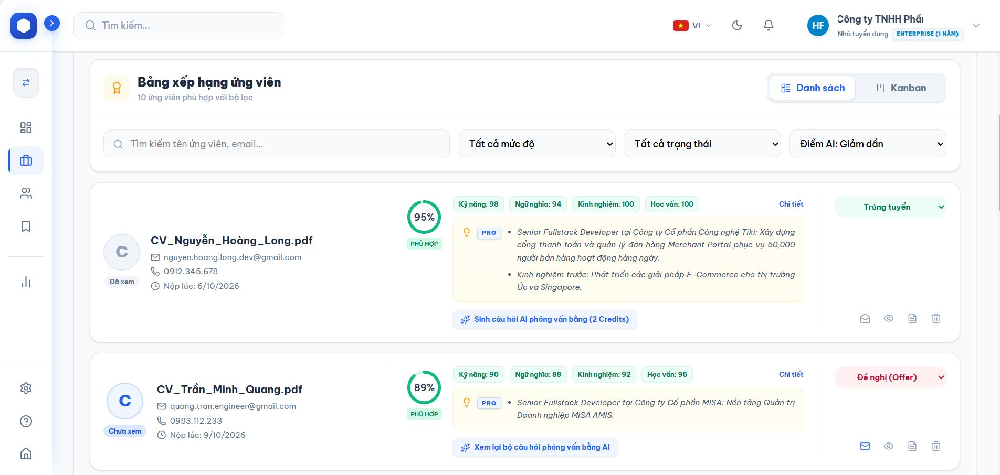
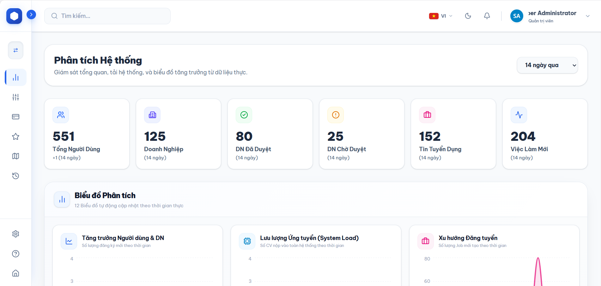

<div align="center">

  <h1>Verisem - Next-Gen AI Recruitment & Talent Assessment Portal</h1>
  <h3>Cổng Thông Tin Tuyển Dụng Thông Minh, Bảng Quản Trị Phễu Ứng Viên & Không Gian Khảo Thí Năng Lực Thời Gian Thực</h3>

  <p>
    Nền tảng giao diện người dùng thế hệ mới, tối ưu hóa toàn diện trải nghiệm tuyển dụng cho 3 phân hệ độc lập: 
    <strong>Doanh nghiệp Tuyển dụng (HR Enterprise)</strong>, <strong>Ứng viên Tìm việc (Job Seeker)</strong> và <strong>Quản trị Hệ thống (Admin Console)</strong>. 
    Tích hợp bảng Kanban quản lý phễu ứng viên kéo thả, không gian tự đánh giá hồ sơ (Self-Score Sandbox), 
    trực quan hóa báo cáo kiểm định tính toàn vẹn hồ sơ (Document Integrity Verification UI) và studio biên tập JD chuẩn hóa.
  </p>

  <p>
    
    
    
    
    
    
    
  </p>

</div>

<br />

# FRONTEND WEB PORTAL & TALENT PIPELINE DASHBOARD

Đây là kho lưu trữ chứa mã nguồn **Frontend** của hệ thống **Verisem (Version 3.0)** — Đồ án tốt nghiệp ngành Công nghệ Thông tin. Ứng dụng được xây dựng theo kiến trúc **Next.js App Router** hiện đại, đáp ứng các tiêu chuẩn công thái học trong trải nghiệm người dùng (UX/UI), đảm bảo tính phản hồi tức thì và tương thích tối ưu trên mọi kích thước màn hình.

---

## Mục lục

- [1. Công nghệ & Thư viện Cốt lõi](#1-công-nghệ--thư-viện-cốt-lõi)
  - [Khung Giao diện & Nền tảng Ứng dụng](#khung-giao-diện--nền-tảng-ứng-dụng)
  - [Thiết kế Giao diện, Hoạt họa & Kiểu chữ](#thiết-kế-giao-diện-hoạt-họa--kiểu-chữ)
  - [Quản lý Trạng thái & Đồng bộ Dữ liệu Máy chủ](#quản-lý-trạng-thái--đồng-bộ-dữ-liệu-máy-chủ)
  - [Trực quan hóa Dữ liệu & Tương tác Nâng cao](#trực-quan-hóa-dữ-liệu--tương-tác-nâng-cao)
- [2. Tính năng Giao diện & Kiến trúc Trải nghiệm Người dùng](#2-tính-năng-giao-diện--kiến-trúc-trải-nghiệm-người-dùng)
  - [2.1. Cổng Thông tin Công cộng & Bảng tin Tuyển dụng (`/public`)](#21-cổng-thông-tin-công-cộng--bảng-tin-tuyển-dụng-public)
  - [2.2. Không gian Ứng viên & Hộp cát Đánh giá Năng lực (`/applicant`)](#22-không-gian-ứng-viên--hộp-cát-đánh-giá-năng-lực-applicant)
  - [2.3. Bảng Quản trị Tuyển dụng Doanh nghiệp (`/hr`)](#23-bảng-quản-trị-tuyển-dụng-doanh-nghiệp-hr)
  - [2.4. Trung tâm Quản trị Hệ thống & Cấu hình Động (`/admin`)](#24-trung-tâm-quản-trị-hệ-thống--cấu-hình-động-admin)
- [3. Demo Giao diện Người dùng](#3-demo-giao-diện-người-dùng)
- [4. Hướng dẫn Cài đặt & Khởi chạy](#4-hướng-dẫn-cài-đặt--khởi-chạy)
- [5. Cấu trúc Thư mục Dự án](#5-cấu-trúc-thư-mục-dự-án)
- [6. Kết nối Backend API Service](#6-kết-nối-backend-api-service)
- [7. Tác giả](#7-tác-giả)

---

## 1. Công nghệ & Thư viện Cốt lõi

Hệ thống được phát triển trên nền tảng công nghệ Front-end hiện đại nhất trong hệ sinh thái React:

### Khung Giao diện & Nền tảng Ứng dụng

| Công nghệ / Thư viện | Phiên bản | Vai trò Kỹ thuật |
| :--- | :--- | :--- |
| **[Next.js](https://nextjs.org/)** | `16.4.3` | Khung ứng dụng React App Router, Server Components và trình biên dịch Turbopack |
| **[React](https://react.dev/)** | `19.3.1` | Thư viện UI cốt lõi phiên bản React 19 tích hợp `babel-plugin-react-compiler` |
| **[TypeScript](https://www.typescriptlang.org/)** | `^5.0.0` | Đảm bảo tính an toàn kiểu dữ liệu (Type Safety) trên toàn bộ dự án |
| **[OpenAPI TypeScript](https://openapi-ts.dev/)** | `^7.13.0` | Tự động biên dịch kiểu dữ liệu tĩnh `api-schema.ts` từ tài liệu Swagger OpenAPI của Backend |

---

### Thiết kế Giao diện, Hoạt họa & Kiểu chữ

| Công nghệ / Thư viện | Phiên bản | Vai trò Kỹ thuật |
| :--- | :--- | :--- |
| **[Tailwind CSS](https://tailwindcss.com/)** | `^4.3.3` | Framework CSS Utility-first thế hệ v4 với kiến trúc CSS-first qua `@tailwindcss/postcss` |
| **[Framer Motion](https://www.framer.com/motion/)** | `^12.43.0` | Xử lý chuyển động mượt mà cho các thành phần điều hướng, modal và hiệu ứng hiển thị |
| **[Lucide React](https://lucide.dev/)** | `^1.61.0` | Bộ biểu tượng SVG đồng bộ, sắc nét và có khả năng tùy biến cao |
| **[next-themes](https://github.com/pacocoursey/next-themes)** | `^0.4.6` | Hỗ trợ chuyển đổi giao diện Sáng / Tối (Light & Dark Mode) mượt mà |
| **[clsx & tailwind-merge](https://github.com/lukeed/clsx)** | `^2.1.1 / ^3.7.0` | Xử lý ghép nối class Tailwind có điều kiện và tránh xung đột thuộc tính |

---

### Quản lý Trạng thái & Đồng bộ Dữ liệu Máy chủ

| Công nghệ / Thư viện | Phiên bản | Vai trò Kỹ thuật |
| :--- | :--- | :--- |
| **[TanStack React Query](https://tanstack.com/query/latest)** | `^5.104.5` | Quản lý trạng thái bất đồng bộ từ máy chủ (Server State), lưu đệm và cập nhật dữ liệu tự động |
| **[Zustand](https://zustand.docs.pmnd.rs/)** | `^5.0.16` | Quản lý trạng thái Client tập trung (`useAuthStore`, `useHRViewStore`, `useUIStore`) |
| **[Axios](https://axios-http.com/)** | `^1.20.0` | Tầng giao tiếp HTTP Client có cài đặt Interceptors tự động đính kèm Token và xử lý lỗi |
| **[js-cookie](https://github.com/js-cookie/js-cookie)** | `^3.0.5` | Điều phối lưu trữ Access Token an toàn trên trình duyệt |

---

### Trực quan hóa Dữ liệu & Tương tác Nâng cao

| Công nghệ / Thư viện | Phiên bản | Vai trò Kỹ thuật |
| :--- | :--- | :--- |
| **[@dnd-kit/core](https://dndkit.com/)** | `^6.3.1` | Bộ công cụ kéo thả hiệu năng cao phục vụ Bảng quản trị phễu ứng viên Kanban |
| **[Recharts](https://recharts.org/)** | `^3.10.1` | Trực quan hóa dữ liệu: Biểu đồ Radar đối sánh kỹ năng ứng viên, biểu đồ theo dõi tuyển dụng |
| **[CKEditor 5](https://ckeditor.com/ckeditor-5/)** | `^48.5.2` | Trình soạn thảo văn bản phong phú (Rich-Text Editor) chuyên biệt cho mô tả công việc JD |
| **[@marsidev/react-turnstile](https://github.com/marsidev/react-turnstile)** | `^1.6.1` | Tích hợp tiện ích bảo vệ chống phần mềm tự động của Cloudflare Turnstile |
| **[@react-oauth/google](https://github.com/MomenSherif/react-oauth)** | `^0.13.4` | Tích hợp giải pháp đăng nhập một chạm với tài khoản Google |
| **[Canvas Confetti](https://github.com/catdad/canvas-confetti)** | `^1.9.4` | Hiệu ứng chúc mừng tương tác khi ứng viên nhận được kết quả tuyển dụng hoặc doanh nghiệp nâng cấp gói |

---

## 2. Tính năng Giao diện & Kiến trúc Trải nghiệm Người dùng

Ứng dụng phân chia kiến trúc giao diện theo mô hình Route Groups độc lập:

### 2.1. Cổng Thông tin Công cộng & Bảng tin Tuyển dụng (`/public`)
* **Trang chủ Khám phá (Landing Page - `/`):**
  Bố cục hiện đại theo phong cách **Bento Grid**, tích hợp các khối thông tin tương tác giới thiệu quy trình sàng lọc hồ sơ tự động, số liệu thống kê thời gian thực của hệ thống và đánh giá từ phía doanh nghiệp.
* **Bộ lọc Việc làm Đa chiều (Faceted Search - `/jobs`):**
  Hỗ trợ tìm kiếm tức thời theo nhiều tiêu chí kết hợp: Lĩnh vực ngành nghề, Địa bàn địa lý 3 cấp hành chính Việt Nam (Tỉnh/Thành phố, Quận/Huyện, Phường/Xã), Mức lương, Cấp bậc kinh nghiệm và Hình thức làm việc (*Trực tiếp, Bán trực tiếp, Từ xa*).
* **Trang Chi tiết Vị trí Tuyển dụng (`/jobs/[id]`):**
  Hiển thị đầy đủ mô tả công việc, chính sách đãi ngộ, văn hóa công ty và danh sách **Tiêu chí Sàng lọc Tiên quyết (Knock-out Criteria)** giúp ứng viên nắm bắt rõ điều kiện bắt buộc trước khi nộp đơn.
* **Bảng Tính toán Gói Thuê bao Tương tác (`/pricing`):**
  Cho phép doanh nghiệp lựa chọn các gói dịch vụ (*FREE, PRO, ENTERPRISE*), tính toán hạn mức Quota phân tích hồ sơ và quét mã thanh toán VietQR động thuận tiện.

---

### 2.2. Không gian Ứng viên & Hộp cát Đánh giá Năng lực (`/applicant`)
* **Kho Lưu trữ Hồ sơ Cá nhân (CV Library):**
  Hỗ trợ ứng viên lưu trữ song song nhiều bản CV khác nhau, tự động trích xuất thông tin học vấn, kỹ năng cốt lõi và số năm kinh nghiệm để hoàn thiện hồ sơ tìm việc.
* **Hộp Cát Tự Đánh Giá Hồ Sơ (AI Self-Score Sandbox - `/applicant/self-score`):**
  * Cho phép ứng viên kéo thả tệp CV bất kỳ và đối chiếu thử với một tin tuyển dụng mục tiêu trên hệ thống.
  * **Biểu đồ Radar Năng lực Đa chiều (Recharts):** Trực quan hóa 4 trụ cột: Kỹ năng chuyên môn, Kinh nghiệm làm việc, Trình độ học vấn và Khả năng diễn đạt ngôn ngữ.
  * **Cảnh báo Kiểm định Cấu trúc Hồ sơ:** Nhắc nhở ứng viên nếu phát hiện các lỗi bố cục nghiêm trọng như văn bản trùng màu nền, cỡ chữ siêu nhỏ hoặc nhồi nhét từ khóa bất thường.
  * **Phân tích Khoảng trống Năng lực (Skill Gap Analysis):** Chỉ rõ các kỹ năng mà nhà tuyển dụng yêu cầu nhưng hồ sơ chưa thể hiện, giúp ứng viên chủ động bồi dưỡng kiến thức.
* **Trình Sinh Thư Ứng Tuyển Tự Động (AI Cover Letter Generator):**
  Trợ lý Gemini hỗ trợ tạo lập thư ứng tuyển cá nhân hóa dựa trên sự kết nối giữa kinh nghiệm thực tế của ứng viên và yêu cầu từ phía công ty.
* **Bảng Theo Dõi Tiến Trình Ứng Tuyển (My Applications Tracker):**
  Cập nhật trạng thái xử lý hồ sơ minh bạch theo thời gian thực (*Đã nộp $\to$ Đang xem xét $\to$ Mời phỏng vấn $\to$ Đề nghị nhận việc $\to$ Tiếp nhận chính thức*).

---

### 2.3. Bảng Quản trị Tuyển dụng Doanh nghiệp (`/hr`)
* **Bảng Quản lý Phễu Tuyển dụng Kéo Thả (Kanban Recruitment Pipeline):**
  Sử dụng thư viện `@dnd-kit`, cho phép chuyên viên nhân sự dễ dàng di chuyển hồ sơ ứng viên giữa các giai đoạn tuyển dụng. Hệ thống tự động kích hoạt thông báo email đến ứng viên khi trạng thái hồ sơ thay đổi.
* **Bộ Sàng Lọc & Xếp Hạng Loạt Hồ Sơ (AI Batch CV Screening):**
  * Tải lên đồng thời nhiều tệp hồ sơ dạng `.pdf` hoặc `.docx`.
  * Hệ thống tự động chấm điểm và phân loại ứng viên theo thứ hạng: **Tier S (Xuất sắc)**, **Tier A (Rất phù hợp)**, **Tier B (Đạt yêu cầu)** và **Tier C (Không phù hợp)**.
  * **Huy hiệu Năng lực & Cảnh báo:** Đánh dấu tự động các hồ sơ vượt kỳ vọng kinh nghiệm, kỹ năng chuyên sâu hoặc cảnh báo vi phạm tiêu chuẩn tài liệu.
  * **Trích dẫn Câu văn Minh chứng (Sentence Attribution):** Hiển thị Top-3 câu văn then chốt nhất trong CV chứng minh mức độ tương thích với JD.
* **Công cụ Săn Ứng viên Theo Ngữ nghĩa (Reverse Matching):**
  Tìm kiếm chủ động trong kho dữ liệu tài năng mở thông qua các truy vấn ngôn ngữ tự nhiên, hệ thống tự động tính toán khoảng cách ngữ nghĩa véc-tơ để gợi ý hồ sơ phù hợp.
* **Studio Soạn Thảo Mô Tả Công Việc (JD Studio):**
  Tích hợp CKEditor 5 hỗ trợ định dạng chuyên nghiệp, bảng thiết lập điều kiện **Knock-out (Loại trực tiếp)** và thanh điều chỉnh trọng số đánh giá linh hoạt theo từng vị trí tuyển dụng.
* **Bộ Công Cụ Phỏng Vấn Chuyên Sâu (AI Interview Kit):**
  Cung cấp danh sách 4 câu hỏi phỏng vấn kỹ thuật hóc búa được sinh tự động từ điểm mù của ứng viên, kèm lý do chất vấn và gợi ý thang điểm đánh giá (Rubric) ngay trong buổi phỏng vấn.

---

### 2.4. Trung tâm Quản trị Hệ thống & Cấu hình Động (`/admin`)
* **Bảng Cấu hình Động Tham số Hệ thống (System Dynamic Configurator):**
  Trực quan hóa và cho phép Quản trị viên điều chỉnh ma trận trọng số ($\mathcal{W}_{\text{skill}}, \mathcal{W}_{\text{nlp}}, \mathcal{W}_{\text{exp}}, \mathcal{W}_{\text{edu}}$ và hệ số lai $\alpha$) theo từng lĩnh vực nghề nghiệp, cập nhật trực tiếp vào cơ sở dữ liệu và đồng bộ vào Redis Cache mà không cần can thiệp mã nguồn.
* **Quy trình Xác thực Pháp nhân Doanh nghiệp (KYC Verification):**
  Kiểm duyệt giấy phép kinh doanh, mã số thuế và thông tin đại diện pháp luật của các công ty mới đăng ký trước khi cấp quyền đăng tin tuyển dụng.
* **Quản trị Danh mục Phân cấp Kỹ năng (Skill Taxonomy Management):**
  Quản lý danh mục hàng nghìn kỹ năng chuẩn (Canonical Names) và các biến thể đồng nghĩa (Aliases), hỗ trợ chuẩn hóa dữ liệu tìm kiếm.
* **Nhật Ký Kiểm Toán Toàn Vẹn Hệ Thống (90-Day Audit Trail Viewer):**
  Theo dõi lịch sử truy cập, các thao tác nhạy cảm và cảnh báo an ninh với cơ chế lọc chi tiết theo thời gian và đối tượng tác động.

---

## 3. Demo Giao diện Người dùng

### 1. Trang Chủ Khám Phá Tuyển Dụng (Landing Page)


### 2. Hộp Cát Đánh Giá Năng Lực Ứng Viên (Applicant Self-Score Sandbox)


### 3. Bảng Quản Trị Phễu Tuyển Dụng Kéo Thả (HR Kanban Pipeline)


### 4. Báo Cáo Kiểm Định Tính Toàn Vẹn Hồ Sơ & Đối Sánh AI (CV Integrity Report)


### 5. Bảng Điều Khiển & Phân Tích Hệ Thống (Admin Analytics Dashboard)


---

## 4. Hướng dẫn Cài đặt & Khởi chạy

### Yêu cầu Hệ thống
* **Node.js:** Phiên bản `>= 20.0.0` (Khuyến nghị **Node.js 20.x** hoặc **22.x LTS**).
* **Trình quản lý gói:** `npm` (>= 9), `yarn`, `pnpm` hoặc `bun`.
* **Backend Service:** Máy chủ **Verisem API Core** đang chạy tại cổng `8000`.

### Quy trình Cài đặt

```bash
# 1. Tải mã nguồn Frontend về máy cục bộ
git clone https://github.com/hvt299/CV-Ranking-Web.git
cd CV-Ranking-Web

# 2. Cài đặt toàn bộ thư viện phụ thuộc
npm install
```

### Cấu hình Biến Môi trường (.env.local)

Tạo tệp `.env.local` tại thư mục gốc của dự án:

```env
# Địa chỉ máy chủ Backend API
NEXT_PUBLIC_API_URL=http://localhost:8000

# Google OAuth 2.0 Client ID
NEXT_PUBLIC_GOOGLE_CLIENT_ID=your_google_client_id_here.apps.googleusercontent.com

# Cloudflare Turnstile Site Key
NEXT_PUBLIC_TURNSTILE_SITE_KEY=your_cloudflare_turnstile_site_key_here
```

### Các Lệnh Thực thi

```bash
# 1. Tự động đồng bộ kiểu dữ liệu TypeScript từ tài liệu OpenAPI Backend
npm run generate-types

# 2. Khởi chạy môi trường phát triển (Dev Server tại port 3000 với Turbopack)
npm run dev

# 3. Biên dịch bản phát hành sản phẩm (Production Build)
npm run build

# 4. Khởi chạy bản production đã biên dịch
npm run start

# 5. Kiểm tra lỗi cú pháp và quy chuẩn mã nguồn (ESLint)
npm run lint
```

Sau khi khởi chạy thành công, truy cập ứng dụng trên trình duyệt tại địa chỉ:
```text
http://localhost:3000
```

---

## 5. Cấu trúc Thư mục Dự án

```text
Verisem-Web/
├── app/                           # Cấu trúc Next.js App Router phân theo Route Groups
│   ├── (admin)/admin/             # Phân hệ Quản trị Hệ thống
│   │   ├── analytics/             # Báo cáo phân tích toàn hệ thống
│   │   ├── audit-logs/            # Nhật ký kiểm toán an ninh
│   │   ├── companies/             # Kiểm duyệt pháp nhân doanh nghiệp KYC
│   │   ├── skills/                # Quản lý danh mục kỹ năng chuẩn
│   │   ├── system-settings/       # Cấu hình ma trận trọng số đánh giá theo ngành
│   │   └── dashboard/             # Bảng điều khiển quản trị tổng quan
│   ├── (applicant)/applicant/     # Phân hệ Dành riêng cho Ứng viên
│   │   ├── cv-library/            # Quản lý kho hồ sơ cá nhân
│   │   ├── self-score/            # Không gian tự đánh giá hồ sơ với JD
│   │   ├── cover-letters/         # Trình tạo thư xin việc tự động bằng AI
│   │   ├── my-applications/       # Theo dõi trạng thái hồ sơ đã nộp
│   │   └── profile/               # Hồ sơ năng lực và thông tin liên hệ
│   ├── (hr)/hr/                   # Phân hệ Dành cho Doanh nghiệp Tuyển dụng
│   │   ├── candidates/            # Quản lý danh sách ứng viên và báo cáo kiểm định
│   │   ├── dashboard/             # Bảng quản lý phễu tuyển dụng Kanban kéo thả
│   │   ├── interviews/            # Bộ câu hỏi phỏng vấn AI và lên lịch họp
│   │   ├── jobs/                  # Studio tạo và biên tập JD kèm tiêu chí Knock-out
│   │   └── analytics/             # Báo cáo hiệu suất tuyển dụng
│   ├── (public)/                  # Các trang thông tin công khai
│   │   ├── jobs/                  # Bảng tin tuyển dụng và bộ lọc đa tiêu chí
│   │   ├── companies/             # Danh bạ doanh nghiệp đã xác thực KYC
│   │   ├── pricing/               # Bảng giá dịch vụ và thanh toán VietQR
│   │   └── page.tsx               # Trang chủ chính của hệ sinh thái Verisem
│   ├── (auth)/                    # Luồng xác thực tài khoản
│   │   ├── login/                 # Đăng nhập mật khẩu và Google OAuth
│   │   ├── register/              # Đăng ký tài khoản Doanh nghiệp / Ứng viên
│   │   └── reset-password/        # Khôi phục mật khẩu bảo mật qua OTP
│   ├── globals.css                # CSS Variables và thiết lập màu sắc giao diện
│   └── layout.tsx                 # Root Layout cấu hình Font, Providers và Modals
├── components/                    # Tầng các thành phần giao diện tái sử dụng
│   ├── ui/                        # Các nguyên tử giao diện (Buttons, Inputs, Badges)
│   ├── charts/                    # Biểu đồ Recharts Radar và thống kê tuyển dụng
│   └── kanban/                    # Bảng quản lý phễu ứng viên kéo thả (@dnd-kit)
├── store/                         # Quản lý trạng thái Client (Zustand Stores)
│   ├── useAuthStore.ts            # Quản lý phiên đăng nhập và quyền hạn người dùng
│   ├── useHRViewStore.ts          # Lưu trữ tùy chọn hiển thị bảng tuyển dụng
│   ├── useLanguageStore.ts        # Quản lý ngôn ngữ hiển thị
│   └── useUIStore.ts              # Trạng thái mở/đóng Modal, Drawer và Sidebar
├── types/                         # Định nghĩa kiểu dữ liệu tĩnh TypeScript
│   ├── api-schema.ts              # Kiểu dữ liệu đồng bộ tự động từ Backend OpenAPI
│   ├── candidate.ts               # Định nghĩa thực thể ứng viên và kết quả chấm điểm
│   └── job.ts                     # Định nghĩa tin tuyển dụng và tiêu chí sàng lọc
├── utils/                         # Các hàm tiện ích bổ trợ
│   ├── format.ts                  # Định dạng tiền tệ VND, thời gian và chuỗi
│   ├── score.ts                   # Xử lý màu sắc và chuẩn hóa thang điểm hiển thị
│   └── tier-colors.ts             # Định nghĩa bảng màu cho các thứ hạng Tier S/A/B/C
├── public/                        # Tài nguyên tệp tĩnh
│   ├── demo/                      # Tệp ảnh chụp màn hình minh họa giao diện
│   └── images/                    # Đồ họa minh họa và hình nền
├── package.json                   # Danh mục thư viện và scripts dự án
└── tsconfig.json                  # Cấu hình kiểm tra kiểu dữ liệu TypeScript
```

---

## 6. Kết nối Backend API Service

Ứng dụng Frontend được thiết kế để kết nối trực tiếp với **Verisem API Core** (chạy tại cổng mặc định `8000`):
* Cấu hình chia sẻ tài nguyên (CORS) đã được mở và kiểm soát an toàn từ phía máy chủ.
* Các yêu cầu HTTP bảo mật tự động được đóng gói kèm `Authorization: Bearer <token>` thông qua Axios Interceptors.
* Đảm bảo cập nhật chính xác địa chỉ API trong tệp cấu hình: `NEXT_PUBLIC_API_URL=http://localhost:8000`.

---

## 7. Tác giả

Đề tài Đồ án Tốt nghiệp được nghiên cứu và hiện thực hóa bởi:

* **Hứa Viết Thái** — Mã sinh viên: `22IT262`  
  Email: [huavietthai299@gmail.com](mailto:huavietthai299@gmail.com) | GitHub: [https://github.com/hvt299](https://github.com/hvt299)
* **Phạm Thế Anh** — Mã sinh viên: `22IT007`  
  Email: [pacman16012004@gmail.com](mailto:pacman16012004@gmail.com) | GitHub: [https://github.com/giodong34567](https://github.com/giodong34567)
